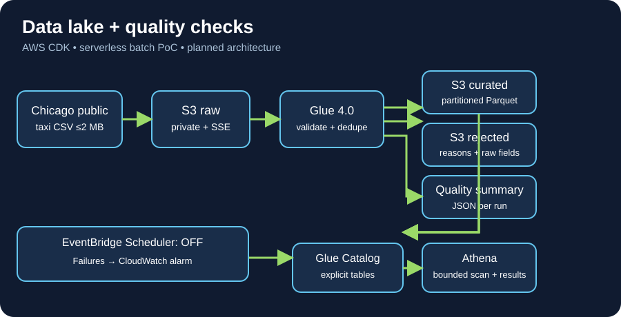
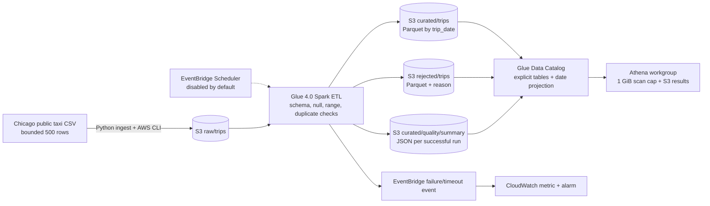

# Serverless S3 data lake with quality checks — PoC #2

A deployable **AWS CDK TypeScript** proof of concept for a small batch data lake, featuring a bounded public Chicago taxi-trip sample, Spark validation, partitioned Parquet, rejected-row audit, and Athena queries. This is infrastructure and code, **not a live demo**. No AWS deployment, query result, performance measurement, or observed bill is claimed.



## Architecture



- **Four separate S3 buckets** (raw, curated, rejected, Athena results) use SSE-S3, all four block public access, deny HTTP, and expire data after 90, 365, 30, and 7 days respectively. Multipart uploads expire after 7 days. `dev` buckets have `DESTROY` policies but **must be emptied manually first**; `prod` buckets are `RETAIN` and persist after stack deletion. No `autoDeleteObjects` wildcard delete role.
- Ingestion (`scripts/ingest.py`) requests **at most 1,000 rows / 2 MB** from the City of Chicago [Taxi Trips (2013–2023)](https://data.cityofchicago.org/Transportation/Taxi-Trips-2013-2023-/wrvz-psew) public Socrata CSV API, then overwrites `raw/trips/sample.csv`. Only four fields are requested: `trip_id`, `trip_start_timestamp`, `trip_miles`, `fare`. Run the script from an AWS CLI profile with write access to the raw bucket. The external API is not under this repo's control and may change or be unavailable; no dataset is checked in. Source row order is deterministic within a given upstream snapshot, not guaranteed fixed across time.
- Glue 4.0 runs a Python 3 Spark job (`glue/job.py`), with pure Python rules in `glue/quality.py` passed via `--extra-py-files`. It checks the CSV header for required fields; row-level checks reject missing required values, invalid timestamps, timestamps outside 2010–2099, non-finite numbers, miles outside 0–1000, and fares outside 0–10000. For duplicate **valid** `trip_id`s it keeps the lexicographically first `(source_file, raw_record)` and rejects the rest. This is a deterministic tie-break for differing rows; identical rows' winning identity is immaterial. Invalid rows are counted separately. Only raw strings and a source path (no extra source fields) are included in the rejected Parquet. Input CSV with a missing required header fails the job, rather than silently accepting it. Malformed CSV rows are treated as missing values where Spark's permissive CSV parser permits; pathological quote/column-count corruption may not be distinguished from nulls. Harden CSV parser and data contracts before production use.
- Output `curated/trips/` is Parquet partitioned by `trip_date=YYYY-MM-DD`; `rejected/trips/` is Parquet with `reason`, and one JSON summary object is written under `curated/quality/summary/` on each successful run: processed, accepted, invalid, duplicates, rejected, rejection_rate. **Snapshot semantics:** each job reads all files under `raw/trips/` and overwrites both trip outputs; keep that prefix small. It does not support concurrent ingestion, transactional publication, or incremental CDC. A failed job may leave partial new output and no summary: review logs and rerun from raw. `maxConcurrentRuns=1` limits concurrent job runs, not simultaneous ingestion.
- Glue Data Catalog defines explicit external `trips`, `rejected_trips`, and `quality_reports` tables. Partition **projection** avoids crawler/`MSCK REPAIR` for date partitions. Athena workgroup enforces SSE-S3 query results, 1 GiB bytes-scanned cutoff per query and a separate 7-day results bucket. See `sql/queries.sql`, selecting workgroup and database for your stage. Athena permissions for human analysts are **not** provisioned; use a separate authorized principal with scoped workgroup, Glue catalog, and bucket access.
- EventBridge Scheduler weekly Monday 06:00 UTC trigger is **DISABLED** by default; enable it deliberately after verifying source ingestion and costs. EventBridge Glue FAILED/TIMEOUT events flow to a dedicated 30-day CloudWatch log group, metric filter and failure alarm. The alarm has **no notification action**: attach your own SNS/incident destination for production. EventBridge events are best-effort and this is not a substitute for monitoring `GetJobRun` status.

## Prerequisites, local verification, and deployment

Node.js **22**, npm, Python **3.11+** with pytest, AWS CLI v2 for ingestion, AWS credentials for deployment, and CDK bootstrap in an account/region you control. PySpark, boto3 and `awsglue` are provided by Glue 4.0 and are **not** required for the local pure-rule tests. The data is public but may still include unique trip IDs; restrict access to rejected/raw zones. No secret or AWS key is stored in this repository.

```bash
npm install
npm run lint
npm test
python -m pip install pytest
python -m pytest tests/test_quality.py tests/test_ingest.py -x -q
npm run synth -- -c stage=dev
npm run synth -- -c stage=prod

# With authorized credentials (bootstrap once per account/region):
npx cdk bootstrap aws://$AWS_ACCOUNT_ID/$AWS_REGION
npx cdk deploy DataLakeQuality-dev -c stage=dev
```

Outputs: `RawBucketName`, `CuratedBucketName`, `RejectedBucketName`, `AthenaResultsBucketName`, `DatabaseName`, `GlueJobName`, `WorkGroupName`. The stack uses `CDK_DEFAULT_ACCOUNT` / `CDK_DEFAULT_REGION` via the current AWS profile; dev/prod stages **do not** provide account isolation. Start with dev; deploy prod only with a separate account and retention review.

### Ingest, run, inspect

```bash
# Replace with deployed output, not a guessed bucket name:
python scripts/ingest.py --bucket "$RAW_BUCKET" --limit 500
aws glue start-job-run --job-name data-lake-quality-dev
# Capture returned JobRunId and wait for SUCCEEDED:
aws glue get-job-run --job-name data-lake-quality-dev --run-id "$JOB_RUN_ID" --query 'JobRun.JobRunState'
# Athena console: workgroup data-lake-quality-dev; database data_lake_quality_dev;
# run statements from sql/queries.sql. Look for quality/summary/<run-id>.json in curated bucket.
```

The CLI caller needs `s3:PutObject` to the raw bucket for ingestion; no end-user upload IAM principal is generated. Running without an uploaded CSV fails the Glue job (expected). Ingestion does **not** automatically start the job. The query file is illustrative; choose a `trip_date` range matching your sample (2013–2023), and Athena scans may incur charges. Don’t enable the schedule until an operator defines a repeatable ingestion cadence.

### Teardown

```bash
# Examine contents first; DEV only, destructive! Replace outputs with your actual bucket names:
for bucket in "$RAW_BUCKET" "$CURATED_BUCKET" "$REJECTED_BUCKET" "$ATHENA_RESULTS_BUCKET"; do
  aws s3 rm "s3://$bucket/" --recursive
done
npx cdk destroy DataLakeQuality-dev -c stage=dev
```

Do **not** run the above deletion loop for prod. Prod bucket data is retained when the stack is destroyed; record bucket names first, and remove retained buckets manually only after legal/backup approval. Verify no active queries or Glue runs. CDK bootstrap assets and any CloudWatch log groups outside this stack may continue to incur charges.

## CI/CD security

`.github/workflows/ci.yml` runs lint, TypeScript assertion tests, Python unit tests and dev synth on pushes/PRs. Deployment runs **only** with `workflow_dispatch`; configure GitHub environments `dev`/`prod` (approval for prod), environment variable `AWS_REGION`, and environment secret `AWS_DEPLOY_ROLE_ARN`. Configure IAM OIDC trust restricted to the repo, approved environment and intended refs; scope deploy permissions to the target account/stack/CDK asset bucket. The deploy role needs CloudFormation/CDK bootstrap, S3, Glue, Scheduler, Athena, EventBridge, Logs, CloudWatch, and IAM permissions for provisioning. No long-lived AWS keys. CI environment approvals, role trust and account billing alerts must be configured outside this repo.

## Well-Architected review (design-time, not an audit)

**Operational Excellence** — Repeatable CDK and local tests, manual deployment gate, per-run summary and alarm. Add runbooks, SNS action, dashboards and an end-to-end deployed test before production.

**Security** — SSE-S3, TLS-only, blocked public access, least-privilege runtime bucket/prefix access, dedicated scheduler role, bounded Athena results. SSE-S3 is not a customer-managed KMS key; no bucket versioning or classification enforcement; raw/rejected access should be tightly governed. AWS principal permissions for ingestion and Athena users must be configured separately.

**Reliability** — Raw copy supports reruns and valid records are deduplicated. Overwrite is **not atomic**; a failed run can partially replace a snapshot, and expiration deletes data even if an incident is ongoing. Add versioning, staged publication, recovery drills and lifecycle review before production.

**Performance Efficiency** — Parquet and date partition projection reduce Athena scans for filtered queries. Spark 2 G.1X workers for 500 rows is for architecture demonstration, not efficiency. Profile larger workloads and check query plans and skew before scaling.

**Cost Optimization** — Disabled schedule prevents unattended jobs; results retention and 1 GiB per-query scan cutoff bound some use. Glue's minimum billed duration/startup, four buckets, Athena data scans, S3 requests/storage, EventBridge, metrics and logs still cost money. The Athena cutoff does **not** cap number of queries or monthly spend; set AWS Budgets externally.

**Sustainability** — Small bounded sample and expiration limit stored data. A Spark startup for 500 rows is disproportionate; consider Lambda or Athena CTAS for a real tiny workload, or batch many datasets per run. No environmental impact was measured.

## Illustrative cost note (not a bill)

For a *hypothetical* one-off dev experiment with one bounded sample, one 2-worker Glue G.1X job, a handful of Athena queries scanning under 1 GiB each, <1 GB across four buckets, one alarm and low log volume, plan a **single-digit USD** starting budget, plus potential bootstrap storage. This is **not a quote**: Glue job startup/minimum billing, DPU rate, region, retries, query count, data growth, CloudWatch logs and account free-tier eligibility can change costs substantially. A weekly schedule multiplies Glue job charges; set an account budget and check [AWS Pricing Calculator](https://calculator.aws/) for your region before enabling it.

## Results: Pending deployment

Local tests and synth validate source-code rules and intended CloudFormation properties only. No AWS deployment, end-to-end run, quality percentage, Athena output, observed cost or alarm firing has been measured. After deployment, record sample size/date, actual quality summary, query outputs, job duration, cost, failure/recovery test and any operational fixes.

## Caveats

- Real Glue/Athena compatibility, Athena partition projection (`NOW` bounds), CSV corruption, event delivery and permissions require integration testing in a sandbox account; no Spark runtime test was run locally.
- `prod` retains buckets but still expires objects on lifecycle deadlines (90/365/30/7 days). Review retention and data protection policy before using real personal information. An external public data API can rate-limit, change its schema, or time out.
- Rejected Parquet and summaries are not partitioned; for larger workloads add partitions or proper small-file compaction. `quality_reports` is append-only until the curated bucket's 365-day lifecycle expires objects.
